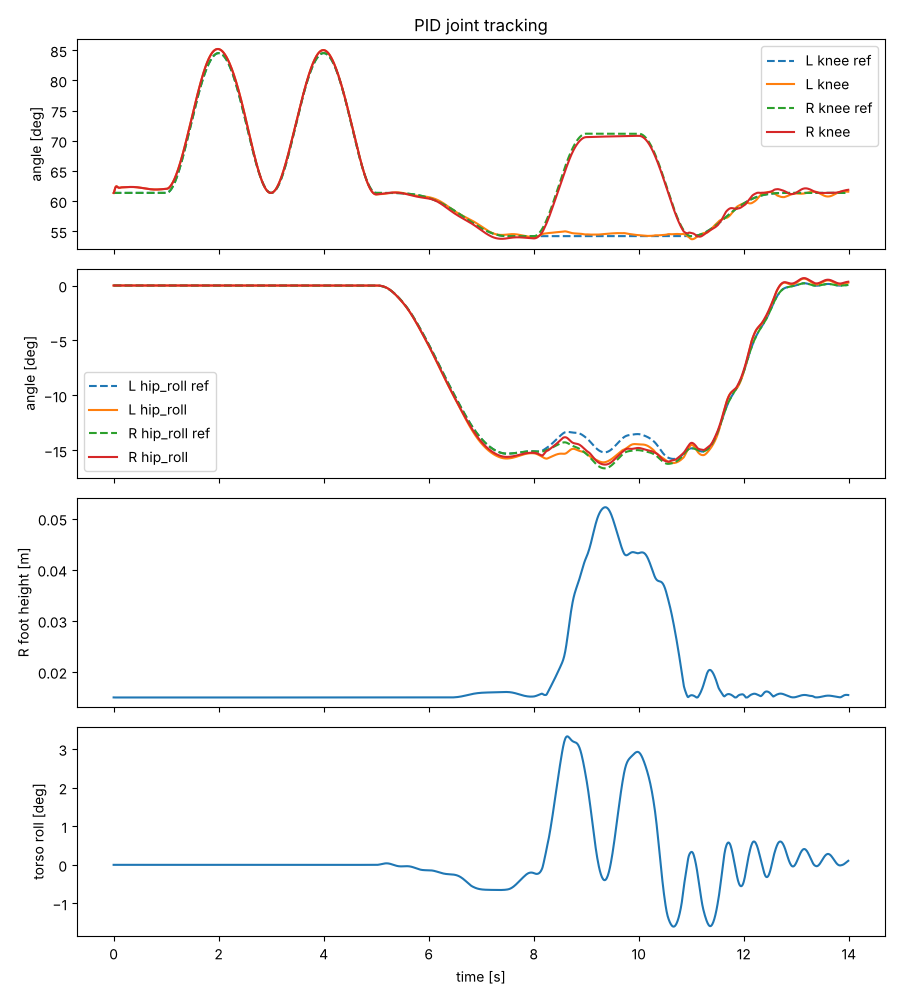

# 1_PID: 관절 PID 토크 제어

10개 관절 각각에 PID를 걸어 기준 관절각을 따라가게 합니다. 기준 관절각은 몸통 높이, 좌우 이동량, 오른발 높이를 역기구학(`leg_ik`)으로 바꿔 만듭니다.

동작 순서 (14초): 서 있기 → 앉았다 일어서기 2회 → 몸통을 왼발 위로 이동 → 오른발 4 cm 들기 → 한 발로 서 있기 → 내리기 → 가운데로 복귀

## 실행
```bash
pip install -r requirements.txt
python main.py --gui          # 창으로 보기
python main.py                # 창 없이 실행 → pid_result.png
python main.py --no-balance   # 몸통 roll 보정(바깥쪽 루프)을 끄고 비교
```

## 코드에서 볼 곳
- `PID` 클래스: 적분 제한(anti-windup), 미분항은 측정 속도로 계산
- `KP, KI, KD`: 관절별 이득. 발목은 뒤에 달린 발이 가벼워서 KD 를 크게 하면 시뮬레이션이 발산합니다 (처음에 KD 8 로 했을 때 실제로 로봇이 튕겨 날아갔습니다).
- `K_ROLL`: 몸통 roll 각도로 hip_roll 기준값을 고치는 비례 제어. 0.5 근처가 가장 덜 흔들렸고 1.0 이상은 넘어졌습니다.

## 확인 결과 (Python 3.11, pybullet 3.2.7)
```
관절별 추종 오차 RMS [deg]: [0.52 0.17 0.4  0.48 0.92 0.22 0.17 0.44 0.38 0.23]
최대 RMS = 0.92 deg
한 발 들기 이후(8 s~) 몸통 roll 최대 = 3.3 deg
결과: 넘어지지 않고 모든 동작 완료
```
명령한 발 높이는 4 cm 인데 몸통이 조금 기울어 실제로는 그보다 낮게 들립니다 (그래프 세 번째 칸).


