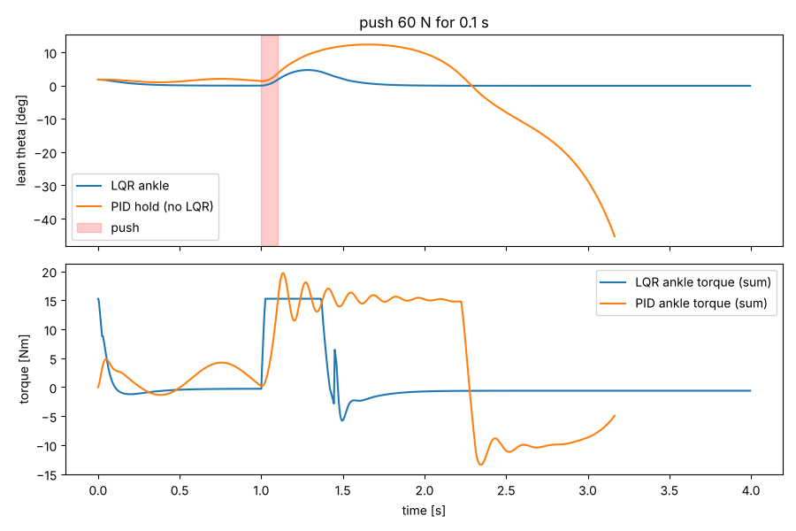

# 2_LQR: 발목 토크 LQR 균형 제어

로봇 전체를 발목을 축으로 하는 역진자(inverted pendulum)로 보고, 몸통을 앞뒤로 밀었을 때 발목 토크로 버팁니다.

- 상태 `x = [theta, theta_dot]`: 발목에서 질량 중심까지 선분이 수직과 이루는 각과 각속도
- 입력 `u`: 양발 ankle_pitch 토크의 합
- 선형화 모델: `theta_ddot = (g/L) theta - u / (m L^2)`
- `scipy.linalg.solve_continuous_are` 로 리카티 방정식을 풀어 `u = -K x`
- 발이 들리지 않도록 ZMP 가 발바닥 안에 있게 토크를 제한 (`u_max, u_min`)
- 발목 이외 관절은 1_PID 와 같은 관절 PID 로 자세 유지

## 실행
```bash
pip install -r requirements.txt
python main.py --gui              # 창으로 보기 (1초에 60 N 으로 0.1초 밀기)
python main.py                    # 창 없이 실행 → lqr_result.png (LQR 과 PID 고정 비교 그래프)
python main.py --push 70          # 미는 힘 바꾸기 (음수면 뒤로). 70 N: 최대 기울기 7.5° 후 복귀 확인
python main.py --compare          # 20~100 N 에서 두 방식 비교 표
```
`Q`, `R` 값을 바꾸면 이득과 닫힌 루프 고유값이 어떻게 바뀌는지 출력으로 바로 볼 수 있습니다.

## 확인 결과 (Python 3.11, pybullet 3.2.7)
```
질량 m = 14.4 kg, 발목~질량중심 높이 L = 0.451 m
LQR 이득 K = [[-515.4  -89.5]],  닫힌 루프 고유값 = [ -6.37 -24.24]
미는 힘 60 N: 최대 기울기 4.68 deg, 마지막 기울기 -0.07 deg
결과: 넘어지지 않고 원래 자세로 복귀

미는 힘[N]   LQR 발목 제어   발목도 PID 로 고정
      50     버팀             버팀
      60     버팀             넘어짐
      70     버팀             넘어짐
      80     넘어짐            넘어짐
```
60 N 에서는 LQR 토크가 발끝 쪽 한계(약 15 Nm)에 닿았다가 돌아옵니다. 그보다 세게 밀면 발목 토크만으로는 못 버팁니다.


