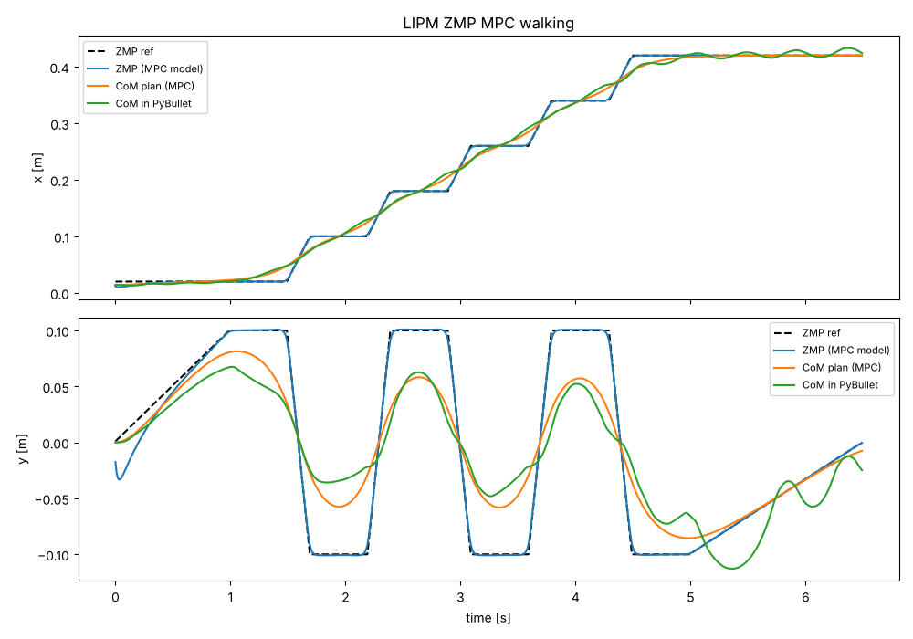

# 3_MPC: LIPM + ZMP MPC 보행

1. 발자국 계획: 보폭, 한 발 지지 시간, 두 발 지지 시간으로 발 위치와 ZMP 기준값을 만듭니다.
2. MPC (0.01 s 마다): LIPM 상태 `[c, c_dot, c_ddot]`, 입력은 jerk. 예측 구간(기본 1.6 s) 동안 ZMP 가 기준값을 따라가고 jerk 가 작도록 하는 비용을 최소화합니다. 제약이 없어서 해가 선형 방정식 한 번으로 나오고, 첫 입력만 쓴 뒤 다음 주기에 다시 풉니다.
3. 몸통 위치 = 계획한 질량 중심 (처음 자세에서 잰 차이만큼 보정), 흔드는 발은 4 cm 높이로 들어 옮깁니다.
4. 역기구학(`leg_ik`)으로 관절각을 구하고 관절 PID 토크로 따라갑니다.

## 실행
```bash
pip install -r requirements.txt
python main.py --gui                          # 창으로 보기 (6걸음)
python main.py                                # 창 없이 실행 → mpc_result.png
python main.py --steps 10 --step-length 0.1
python main.py --t-ss 0.4 --t-ds 0.1          # 더 빠르게
python main.py --horizon 0.8                  # 예측 구간 줄여 보기 (이 경우 넘어집니다)
python main.py --pybullet-pd                  # 관절 PID 대신 PyBullet 내장 POSITION_CONTROL
```

## 알아둘 점
- MPC 는 시뮬레이션에서 잰 질량 중심을 다시 넣지 않고 내부 모델 상태로 계속 풉니다. 즉 걷기 패턴을 만드는 용도이고, 밀림 같은 외란에 대한 되먹임은 없습니다.
- 1_PID 의 관절 이득으로는 발목이 물러서 몸이 기울어 넘어졌습니다. 그래서 이 폴더는 이득을 올렸습니다 (`KP` 1500/1000).

## 확인 결과 (Python 3.11, pybullet 3.2.7)
| 옵션 | 결과 | 몸통 최종 x (계획 발 위치) |
|---|---|---|
| 기본 (6걸음, 8 cm) | 끝까지 걸음 | 0.411 m (0.400) |
| `--pybullet-pd` | 끝까지 걸음 | 0.406 m (0.400) |
| `--steps 10` | 끝까지 걸음 | 0.732 m (0.720) |
| `--steps 10 --step-length 0.1` | 끝까지 걸음 | 0.899 m (0.900) |
| `--steps 8 --step-length 0.12` | 끝까지 걸음 | 0.869 m (0.840) |
| `--t-ss 0.4 --t-ds 0.1` | 끝까지 걸음 | 0.424 m (0.400) |
| `--horizon 0.8` | 1.67 s 에 넘어짐 | - |

예측 구간을 0.8 s 로 줄이면 다음 발자국의 ZMP 변화를 충분히 미리 보지 못해 넘어집니다. 기본값 1.6 s 에서는 걷습니다.


