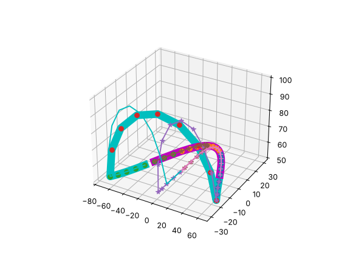

# Einsbon/bipedal-robot-walking-simulation

- 원본: https://github.com/Einsbon/bipedal-robot-walking-simulation (MIT, Copyright (c) 2018 Sunbin Kim)
- README 설명: "bipedal robot walking simulation using pybullet."

## 1. 성격
**PID / LQR / MPC 중 어디에도 해당하지 않습니다.**
- 걷는 동작을 미리 점(walk point)으로 만들어 두고, 역기구학으로 관절각을 구한 뒤 시간에 맞춰 재생합니다.
- 관절은 PyBullet 의 `POSITION_CONTROL`(`positionGain=0.5`, `velocityGain=0.5`, 최대 토크 1.5)로 따라갑니다. 엔진 안의 위치/속도 이득 제어이고, 사용자가 짠 PID 는 없습니다.
- 몸의 기울기나 ZMP 를 재서 고치는 되먹임 균형 제어가 없습니다.

## 2. 원본 구조와 제어 방식
| 파일 | 역할 |
|---|---|
| `walking_simulation_example.py` | 실행 예제. PyBullet 연결(GUI 고정), 로봇 불러오기, 보행 파라미터 설정, 걷기 → 앉았다 서기 → Enter 키로 걷기/멈추기 무한 루프 |
| `walkGenerator.py` | `WalkGenerator` 클래스. `setWalkParameter()` 로 보폭(stride), 발 높이(height), 앉은 높이(sit), 몸 흔들림(swayBody) 등 지정 (단위 mm). `generate()` 가 보행 점을, `inverseKinematicsAll()` / `inverseKinematicsPoint()` 가 다리마다 해석적 역기구학으로 관절각을 만듦. `showGaitPoint2D/3D()` 는 matplotlib 그림 |
| `motorController.py` | `MotorController` 클래스. `setMotorsAngleInFixedTimestep(목표각, 시간, 지연)` 이 현재각에서 목표각까지 선형으로 나눠 매 스텝 `POSITION_CONTROL` 명령 + `stepSimulation()` |
| `play_various_walking.py` | 여러 보행 파라미터로 걷는 예제 |
| `humanoid_leg_12dof.8.urdf` | 다리 12 자유도 로봇 (다리당 hip Z, hip X, hip Y, knee Y, ankle Y, ankle X) |

처리 흐름: 보행 파라미터 → 보행 점(발 위치, mm) → 해석적 역기구학 → 관절각 표 → 시간에 맞춰 위치 제어로 재생.
물리 설정: 시간 간격 1/2000 s, 솔버 반복 200.

## 3. 원본 소스
[`original/`](original/) 에 받은 그대로 있습니다.

## 4. PyBullet 실행 코드 ([`pybullet/`](pybullet/))
원래 PyBullet 프로젝트라서 제어 방식은 그대로 두고, 지금 버전에서 돌아가지 않거나 노트북에서 쓰기 불편한 부분만 고쳤습니다.

| 바꾼 점 | 이유 |
|---|---|
| `motorController.py`: `dtype=np.float` → `dtype=float` | numpy 1.24 에서 `np.float` 이 삭제되어 원본은 실행 즉시 오류 |
| `main.py`: `--gui` 없으면 창 없이(DIRECT) 실행 | 원본은 GUI 고정 |
| `main.py`: Enter 키 대기 무한 루프 제거, 정해진 횟수만 걷기 | 끝나야 결과를 출력할 수 있음 |
| `main.py`: `showGaitPoint3D()` 그림을 창 대신 png 로 저장 | 원본은 창이 뜨면 멈춤 |
| `main.py`: 이동 거리, 자세, 넘어짐 여부 출력 | 확인용 |

`walkGenerator.py` 는 원본 그대로이고, 보행 파라미터와 물리 설정도 원본 값 그대로입니다.

```bash
cd pybullet
pip install -r requirements.txt
python main.py --gui --realtime     # 창으로 보기
python main.py                      # 창 없이 실행
python main.py --cycles 8 --stride 70
```

확인 결과 (Python 3.11, pybullet 3.2.7, numpy 2.4.6):
```
반복 4 회, 보폭 90 mm
몸통 이동: x 0.810 m, y -0.002 m
마지막 자세 roll/pitch/yaw [deg] = [-0.  0.  1.], 몸통 높이 0.253 m (처음 0.253 m)
결과: 넘어지지 않고 끝까지 걸음
```

