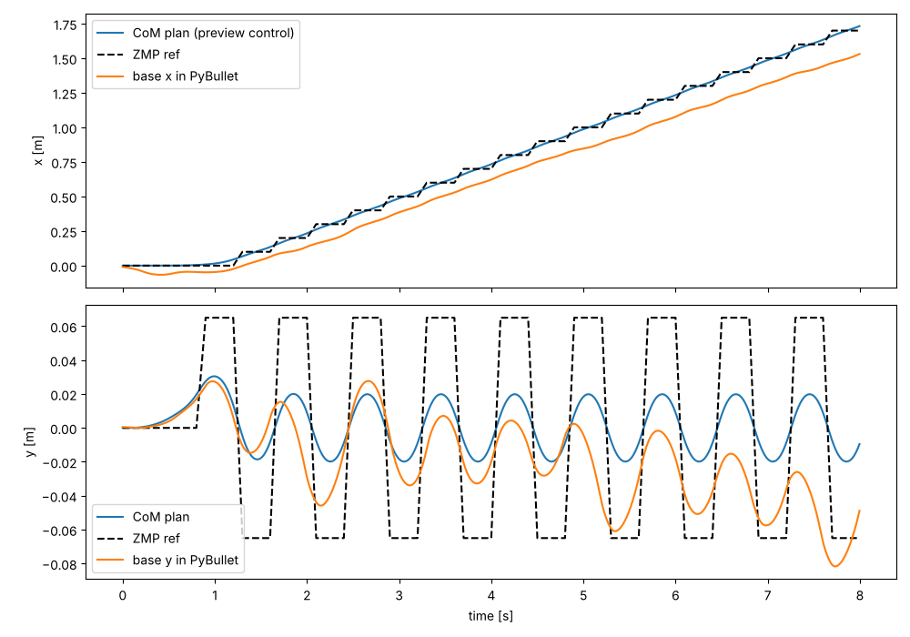

# haruki1526/LeggedRobotsForBullet

- 원본: https://github.com/haruki1526/LeggedRobotsForBullet (MIT, Copyright (c) 2019 Haruki Takamura)
- README 설명: "This repository is a walking robot simulator using pybullet." 이족(bipedal) 예제는 Preview Control, 사족(quadrupedal) 예제는 Inverse Kinematics.
- 이 폴더는 이족(`bipedal/`) 부분을 분석했습니다. 사족 부분은 원본 소스만 넣었고 메시 파일은 받지 않았습니다.

## 1. 성격
**ZMP preview control** 입니다. PID/LQR/MPC 로 나누면 **LQR 계열**에 가깝습니다.
- 질량 중심(CoM) 높이를 일정하게 두는 모델(`A, B, C` 행렬, 입력은 jerk, 출력은 ZMP `C = [1, 0, -CoMheight/g]`) 위에서
- ZMP 오차의 누적을 상태에 더한 확장 시스템으로 이차 비용(`Q = diag(7000, 1, 1, 1)`, `R = 1`)을 세우고
- `control.dare()` (이산시간 리카티 방정식)로 상태 되먹임 이득 `F` 와 미래 ZMP 목표에 곱하는 예견 이득 `Fr` 을 한 번 계산합니다.
- 미래 목표를 미리 본다는 점은 MPC 와 비슷하지만, 매 순간 최적화를 다시 풀지 않고 고정 이득을 쓰며 제약도 없습니다.
- 몸의 실제 상태를 다시 넣지 않으므로(계산한 CoM 궤적을 그대로 따라감) 걷기 패턴 생성 용도입니다.

## 2. 원본 구조와 제어 방식 (`bipedal/`)
| 파일 | 역할 |
|---|---|
| `example_preview_control.py` | 실행 예제. 50걸음, 보폭 0.1 m. 한 걸음마다 CoM 궤적과 양발 궤적을 받아 역기구학 → 관절 위치 명령 |
| `walking_generator.py` | `PreviewControl` 클래스. 위의 preview control 이득 계산, ZMP 목표 생성(`targetZMPgenerator`), 한 걸음 분량 CoM 궤적 계산(`footPrintAndCOMtrajectoryGenerator`), 발 궤적(`footTrajectoryGenerator`) |
| `swing_trajectory.py` | 흔드는 발 궤적. x, y 는 시작/끝 위치와 속도를 맞추는 3차 다항식, z 는 중간 시점에 시작 높이 + `zheight` 를 지나는 3차 다항식 |
| `robot.py` | `Robot`, `Bipedal` 클래스. PyBullet 연결(GUI 고정), 다리당 6관절(hip yaw, hip roll, hip pitch, knee, ankle pitch, ankle roll), 순기구학, 자코비안, 역기구학(`q + λ J⁻¹ [Δp, Δω]` 를 매 스텝 한 번), `POSITION_CONTROL` (최대 힘 9.0) |
| `tform.py` | 회전 행렬, 로드리게스 식 등 좌표 변환 |
| `urdf/bipedal.urdf` + `meshes/stl/` | 로봇 모델. 허벅지·정강이 0.18 m |

예제의 값: 한 발 지지 0.3 s, 두 발 지지 0.1 s, 예견 스텝 190 (1/240 s 간격), CoM 높이 0.45 m.

## 3. 원본 소스
[`original/`](original/) 에 받은 그대로 있습니다. 이족 메시(`bipedal/meshes/stl/`)는 URDF 에 적힌 파일 이름으로 따로 받았습니다.

## 4. PyBullet 실행 코드 ([`pybullet/`](pybullet/))
원래 PyBullet 프로젝트라서 제어 방식은 그대로 두고, 지금 버전에서 돌아가지 않는 부분과 창 관련 부분만 고쳤습니다. 바꾼 줄에는 `[변경]` 주석이 있습니다.

| 바꾼 점 | 이유 |
|---|---|
| `robot.py` 자코비안: `np.vstack(generator)` → `np.vstack([list])` | 최신 numpy 에서 generator 를 받지 않아 원본은 오류로 멈춤 (직접 확인) |
| `walking_generator.py`: `self.x[1]` → `self.x[1, 0]` (2곳) | `np.matrix` 원소로 배열을 만들 때 최신 numpy 에서 오류 (직접 확인) |
| `robot.py`: `gui` 인자 추가, 카메라 이동과 `time.sleep` 은 GUI 일 때만 | 창 없이 빠르게 실행 |
| `main.py` (원본 `example_preview_control.py` 기반): 걸음 수·보폭 인자, 넘어짐 판정, 결과 출력, 그래프 png 저장 | 원본은 그래프 창(`plt.show()`)에서 멈춤 |

preview control 값(`Q`, `R`, 예견 스텝, 지지 시간)과 로봇, 역기구학은 원본 그대로입니다.

```bash
cd pybullet
pip install -r requirements.txt
python main.py --gui          # 창으로 보기
python main.py                # 창 없이 20걸음
python main.py --cycles 50    # 원본 예제와 같은 50걸음
```

확인 결과 (Python 3.11, pybullet 3.2.7, numpy 2.4.6, python-control 0.10.2):
```
걸음 수 20, 보폭 0.1 m
계획한 질량 중심 최종 x = 1.733 m, 시뮬레이션 몸통 최종 x = 1.531 m, 높이 0.489 m
마지막 자세 roll/pitch/yaw [deg] = [-1.9 -2.1 -4.9]
결과: 넘어지지 않고 끝까지 걸음
```
계획보다 약 0.2 m 덜 갔습니다. 몸의 실제 위치를 되먹임하지 않기 때문에 발이 미끄러지거나 덜 디딘 만큼이 그대로 남습니다.


