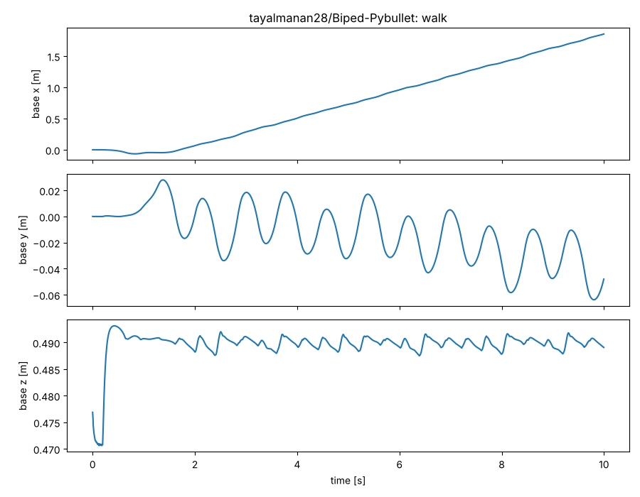

# tayalmanan28/Biped-Pybullet

- 원본: https://github.com/tayalmanan28/Biped-Pybullet (MIT, Copyright (c) 2022 Manan Tayal)
- README 설명: "The Biped can walk, stand, squat, jump with Twist, jump without Twist and Twist its torso"

## 1. 성격
**ZMP preview control** 입니다 (LQR 계열). [02_haruki1526](../02_haruki1526_LeggedRobotsForBullet/) 과 같은 방식입니다.

**02 와의 관계 (코드를 비교해서 확인한 사실):** 파일 구성(`robot.py`, `walking.py`, `trajectory.py`, `transform.py`)과 클래스, 함수 흐름이 02의 `robot.py`, `walking_generator.py`, `swing_trajectory.py`, `tform.py` 와 같고, `Q = diag(7000, 1, 1, 1)`, `R = 1`, 다리 길이 0.18 m, 고관절 간격 0.065 m, 최대 힘 9.0, 초기 관절각 같은 값도 같습니다. 변수 이름과 줄 바꿈이 정리된 형태입니다. 원본 README 에는 02 저장소 언급이 없습니다.

02 에 없는 것:
- 동작 6가지: `walk`, `stand`, `squat`, `jump_w_Twist`, `jump_wo_Twist`, `torsoTwist`
- GUI 슬라이더: Incline(바닥 경사), Stride(보폭), Step height(발 높이). 경사에 맞춰 목표 자세의 pitch 를 바꿈
- 바닥 마찰 60

## 2. 원본 구조와 제어 방식
| 파일 | 역할 |
|---|---|
| `main.py` | `--action` 으로 동작 선택. 모든 동작이 `while True` 무한 반복 |
| `walking.py` | `PreviewControl` 클래스 (02 와 같은 preview control, `control.dare()`) |
| `trajectory.py` | 흔드는 발 궤적 (3차 다항식) |
| `robot.py` | `Robot`, `Biped` 클래스. `SHARED_MEMORY` 후 `GUI` 연결, 슬라이더, 자코비안 역기구학, `POSITION_CONTROL` |
| `transform.py` | 좌표 변환 |
| `biped.urdf` + `meshes/stl/` | 로봇 모델 (02 와 같은 메시 이름) |

## 3. 원본 소스
[`original/`](original/) 에 받은 그대로 있습니다 (메시 포함).

## 4. PyBullet 실행 코드 ([`pybullet/`](pybullet/))
바꾼 줄에는 `[변경]` 주석이 있습니다.

| 바꾼 점 | 이유 |
|---|---|
| `robot.py` 자코비안: `np.vstack(generator)` → `np.vstack([list])` | 최신 numpy 에서 원본은 오류로 멈춤 (직접 확인) |
| `robot.py`: `gui`, `params` 인자 추가. 창이 없으면 슬라이더 대신 명령행 값 사용 | 창 없는 모드에서는 슬라이더를 읽을 수 없음 |
| `robot.py`: 바닥을 만들 때 슬라이더 id 를 각도로 넣던 줄을 `params['incline']` 로 | 원본은 id(0)를 각도로 넣고 있었음 (결과적으로 0이라 동작에는 영향 없음) |
| `main.py`: 원본 동작 함수 그대로 두고, `--time` 초가 지나면 멈춤. 기록, 넘어짐 판정, 그래프 저장 | 원본은 끝없이 돌아서 결과를 볼 수 없음 |

```bash
cd pybullet
pip install -r requirements.txt
python main.py --gui                      # 창으로 보기 (슬라이더 사용 가능)
python main.py                            # 창 없이 walk 10 초
python main.py --action squat --time 5
python main.py --stride 0.15 --step-height 0.05
```

확인 결과 (창 없이 10초씩, Python 3.11, pybullet 3.2.7, numpy 2.4.6):
| 동작 | 몸통 최종 x | 높이 | 마지막 roll/pitch/yaw [deg] | 결과 |
|---|---|---|---|---|
| walk | 1.853 m | 0.489 m | -1.1 / -1.0 / -2.3 | 넘어지지 않음 |
| stand | -0.048 m | 0.491 m | 0.1 / 0.3 / -0.4 | 넘어지지 않음 |
| squat | -0.122 m | 0.375 m | 0.0 / 1.0 / 0.4 | 넘어지지 않음 |
| jump_wo_Twist | -0.409 m | 0.352 m | 0.2 / -2.0 / -1.3 | 넘어지지 않음 (뒤로 0.4 m 밀림) |
| jump_w_Twist | 0.028 m | 0.335 m | 1.7 / -4.9 / -109.8 | 넘어지지 않음 (몸이 110° 돌아감) |
| torsoTwist | -0.027 m | 0.491 m | -0.1 / -0.1 / -4.2 | 넘어지지 않음 |


