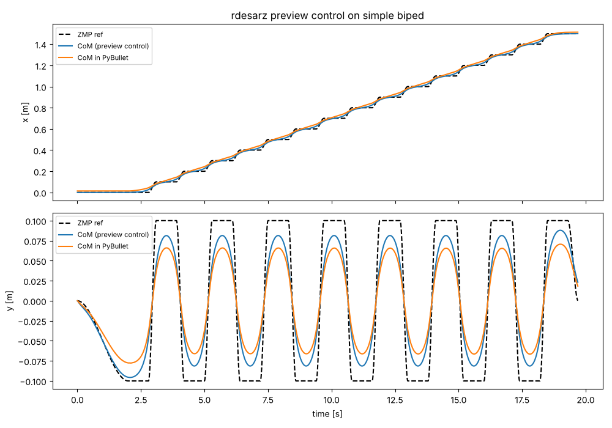

# rdesarz/biped-walking-controller

- 원본: https://github.com/rdesarz/biped-walking-controller (MIT, Copyright (c) 2025 Romain Desarzens)
- README 설명: "open-source implementation of the Linear Inverted Pendulum Model (LIPM) walking pattern generator based on preview control of the Zero-Moment Point (ZMP), following the formulation introduced by Kajita et al. ... ICRA 2003"

## 1. 성격
**LIPM + ZMP preview control** 입니다 (LQR 계열). 여기에 **QP 로 푸는 역기구학**이 붙습니다.
- `preview_control.py`: jerk 입력 LIPM(cart-table) 모델, ZMP 오차 적분을 더한 확장 시스템, `scipy.linalg.solve_discrete_are` 로 이득 `Gi`(적분), `Gx`(상태), `Gd`(예견) 계산. 코드 주석의 참고 문헌: Kajita et al. 2003, Katayama et al. 1985.
- 기본 가중치: `Qe = 1`, `Qx = 0`, `R = 1e-6`, 예견 구간 1.6 s.
- 매 스텝 `update_control()` 로 jerk 를 구해 CoM 을 갱신합니다. 예제 4는 측정 ZMP 자리에 기준 ZMP 를 넣으므로, 몸의 실제 상태를 되먹임하지 않는 패턴 생성 방식입니다.
- 02, 03 과 같은 계열의 제어기를 더 정리된 형태(데이터클래스, 문서, 테스트)로 구현했습니다.

## 2. 원본 구조와 제어 방식
| 파일 | 역할 |
|---|---|
| `biped_walking_controller/preview_control.py` | preview control 이득 계산, 제어 갱신, ZMP 기준 생성(`compute_zmp_ref`), 예견 구간 생성, `CentroidalPlanner` |
| `biped_walking_controller/foot.py` | 발자국 순서(`compute_steps_sequence`), 발 궤적(`compute_feet_trajectories`, 5차 Bezier 곡선), 지지 다각형(shapely) |
| `biped_walking_controller/state_machine.py` | 보행 상태(INIT, DS, SS_LEFT, SS_RIGHT, END)와 접촉 힘 기준 상태 전환 |
| `biped_walking_controller/inverse_kinematic.py` | Pinocchio + qpsolvers 로 CoM, 발, 몸통 목표를 동시에 맞추는 QP 역기구학 |
| `biped_walking_controller/model.py` | Talos 로봇 모델 (talos_data 저장소의 `talos_full.urdf` 를 Pinocchio 로 읽음) |
| `biped_walking_controller/simulation.py` | PyBullet 시뮬레이터 (`POSITION_CONTROL`, `positionGain=0.4`, 최대 힘의 0.8) |
| `examples/example_1~4` | 1: preview control 만, 2: 발 궤적, 3: 역기구학 보행(meshcat 시각화), 4: PyBullet 물리 시뮬레이션 |
| `tests/test_preview_control.py` | preview control 테스트 |

예제 4 값: 1/240 s, 한 발 지지 0.8 s, 두 발 지지 0.3 s, 시작 2.0 s, 끝 0.4 s, 15걸음, 보폭 0.1 m, 발 높이 0.01 m, CoM 높이 0.89 m.
의존성: numpy, scipy, matplotlib, shapely, meshcat, qpsolvers, osqp, pin(Pinocchio), pybullet. Dockerfile 은 `stack-of-tasks/talos-data` 를 clone 해서 씁니다.

## 3. 원본 소스
[`original/`](original/) 에 받은 그대로 있습니다 (문서 `docs/`, Dockerfile, 테스트 포함. 문서 그림은 빠짐).

## 4. PyBullet 실행 코드 ([`pybullet/`](pybullet/))
원본 예제 4는 Talos 모델 데이터(별도 저장소, 메시 포함)와 Pinocchio 가 있어야 하고 pyproject 에 Linux 만 표기되어 있어, 노트북에서 바로 돌리기 어렵습니다. 그래서 **제어기는 원본 모듈을 그대로 쓰고 로봇만 바꿨습니다.**

| 구분 | 내용 |
|---|---|
| 원본 그대로 | `preview_control.py` (아래 numpy 수정만), `foot.py`, `state_machine.py`, 예제 4의 실행 순서(1초 안정화 → 발자국 → 발 궤적 → ZMP 기준 → 걷기 루프), 가중치, 지지 시간 |
| 바꾼 것 | Talos + Pinocchio QP 역기구학 → 단순 이족 로봇(`biped_model.py`, URDF 자동 생성, 전체 14.4 kg)과 해석적 역기구학(`leg_ik`) |
| 바꾼 값 | CoM 높이 0.89 m → 이 로봇의 0.501 m (시작할 때 잰 값), 발 높이 0.01 → 0.03 m, 시간 간격 1/240 → 1/1000 s |
| numpy 수정 | `preview_control.py` 의 6줄에 `.item()` 추가 (`[변경]` 주석 4개). numpy 2.x 에서 (1,1) 배열을 스칼라로 바꾸는 부분이 오류 (원본으로 직접 확인) |
| 좌표 맞춤 | 원본 `BezierCurveFootPathGenerator` 는 z 제어점을 0 기준 절댓값으로 넣으므로, 발바닥 높이 z = 0 으로 계획하고 관절 명령 때 발목 높이를 더함. 처음에 이것을 몰라 발목 높이(0.05 m)로 계획했더니 흔드는 발이 바닥 아래로 내려가 첫 걸음에 넘어졌음 |

```bash
cd pybullet
pip install -r requirements.txt
python main.py --gui              # 창으로 보기
python main.py                    # 창 없이 15걸음
python main.py --t-ss 0.5 --t-ds 0.2
```

확인 결과 (Python 3.11, pybullet 3.2.7, numpy 2.4.6):
```
걸음 수 15, 보폭 0.1 m, zc = 0.501 m, preview 구간 1.6 s
계획 발 위치 최종 x = 1.500 m, 시뮬레이션 발목 x = 왼 1.500, 오른 1.500 m
계획 질량 중심과 시뮬레이션 질량 중심 차이 최대: x 2.0 cm, y 1.8 cm
결과: 넘어지지 않고 끝까지 걸음
```
- `--t-ss 0.5 --t-ds 0.2` 도 넘어지지 않고 걸었습니다.
- 걸음 수가 짝수면(예: 8) 마지막 발 모으기 걸음이 실행되지 않아 두 발이 0.1 m 어긋난 채 끝납니다. 원본 `compute_feet_trajectories` 의 반복 범위 때문이고, 원본 기본값(15)처럼 홀수면 나란히 모입니다.


